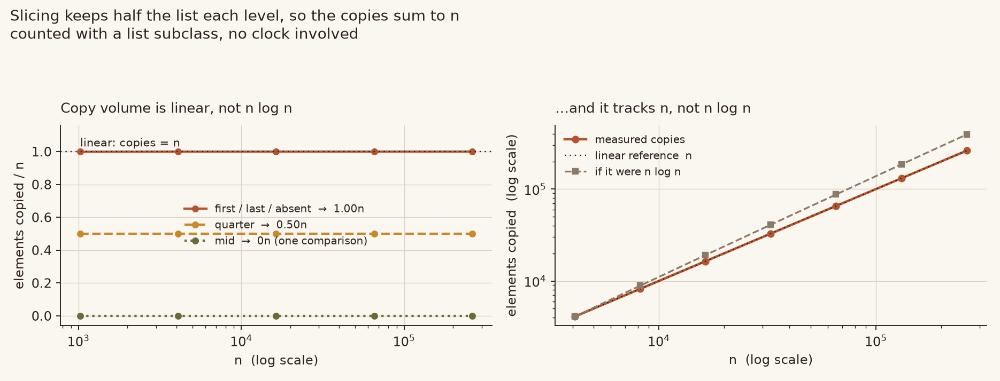
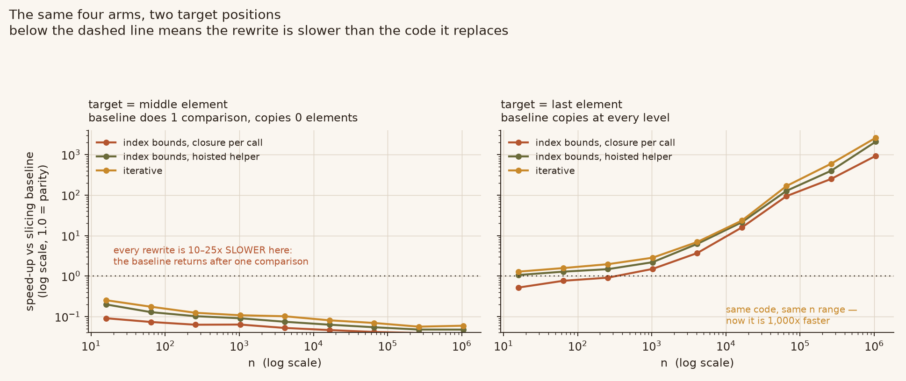
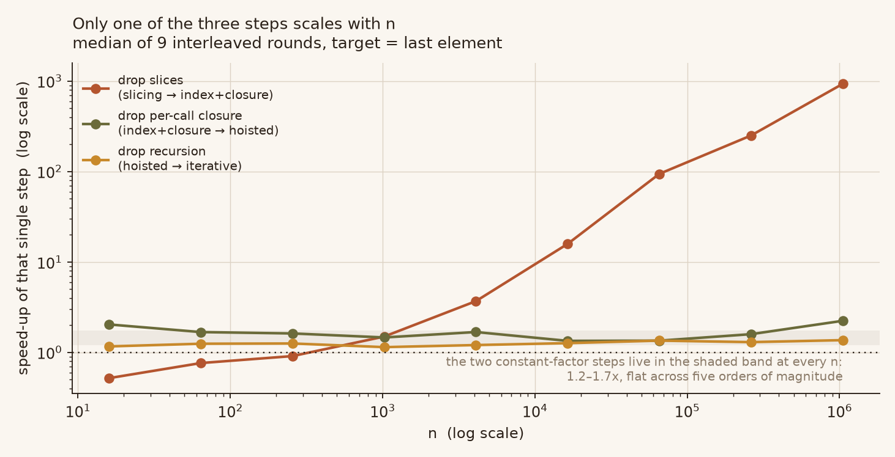

# binary-search-slice-lab

Four binary-search arms, and three corrections to a widely repeated explanation
of why the slicing version is slow.

The story usually goes: `a_list[:midpoint]` copies the list, the recursion is
`log n` deep, therefore the total is `Θ(n log n)`. Only the first clause is
true. Slicing keeps *half*, so the copy volume is `n/2 + n/4 + n/8 + … = n` —
linear, not `n log n`. Measured with a list subclass that counts every copied
element, the ratio `copies / n` sits at **1.00** across a 256× range of `n`.

Two more claims from the same write-up do not survive either: that the slicing
version "hits the recursion limit earlier", and that the rewrite is faster at
every size. Recursion depth is identical for both arms, and below `n ≈ 256` the
rewrite loses to the code it replaces.

```
                        speed-up vs the slicing baseline
                        target=last element   target=middle element
                          n=16     n=1,048,576    n=16    n=1,048,576
  slicing baseline        1.00x       1.00x        1.00x      1.00x
  index + closure/call    0.52x     933x           0.09x      0.04x
  index + hoisted helper  1.06x   2,089x           0.20x      0.05x
  iterative               1.29x   2,608x           0.25x      0.06x
```

Read the two right-hand columns together. The rewrite is worth 2,608× on one
workload and is 16× *slower* on the other, and both are honest binary searches
on a sorted list of the same size.

## The complexity claim, in one picture



Left: elements copied per lookup, divided by `n`. It is flat. A `Θ(n log n)`
implementation would climb with `log n`; this does not move. Right: the absolute
copy count against an `n` reference and an `n log n` reference — it tracks `n`.

Counted by intercepting `__getitem__` on a `list` subclass, with slices
re-wrapped so nested levels are counted too. A naive counter that returns a plain
`list` only sees the first slice and reports `0.5n`, which is exactly the number
that makes the `n log n` story look plausible.

**No clock is involved in this figure.** `benchmarks/ops.py --check` recomputes
every cell in CI and fails on any drift, so the claim is not a measurement
artefact.

## Speed-up depends on which element you look up



Same four arms, same `n` range, two different target positions.

Looking up the **middle** element, the baseline returns after a single comparison
and copies nothing. Every rewrite then pays its own setup cost and loses by
10–25×. Looking up the **last** element, the baseline slices at every level and
the rewrite wins by three orders of magnitude.

Neither panel is the "real" answer. A benchmark that probes `data[len//2]` — which
is what the reviewed write-up does — measures the degenerate case and reports a
number that only holds there. Report both, or the number means nothing.

## Only one of the three steps scales with `n`



Four arms, each differing from the previous by exactly one idea:

| step | change | worth |
|---|---|---|
| slicing → index+closure | stop copying the list | 0.52x → 933x, scaling with `n` |
| index+closure → hoisted | stop rebuilding the closure per call | flat **1.2–2.2x** |
| hoisted → iterative | stop recursing | flat **1.15–1.37x** |

The second and third steps are constant-factor wins. They are real, and together
they are worth roughly 2x, but they do not change the complexity class — and the
first step is worth up to 933x on its own. Quoting the total without splitting it
credits the cheap steps with the expensive one's work.

One caveat worth stating: at `n = 1,048,576` the closure step measures 2.24x
rather than its usual 1.2–1.6x. That is the one cell where the spread is wide
(p10–p90 of 1.72–3.04) and it is probably allocator pressure from the 8 MB
baseline copies, not a real change in the closure cost. The flat band in the
figure stops at `n = 262,144` for that reason.

The closure is the interesting one because it is a *regression*. `binary_search`
in the reviewed package defines `_search` inside the function body, so every call
allocates a new function object before doing any searching. That costs about
0.3 µs, independent of `n` — which is why the arm that "optimises" the search is
slower than the original at small sizes.

## Measured numbers

Median of per-round ratios, 9 interleaved rounds, CPython 3.13.12 on Windows.
Brackets are p10–p90. Absolute microseconds are deliberately absent: they drift
by up to 3x inside one process, so they are only useful for scale, and the raw
values are in `benchmarks/timing.json`.

Target = last element (the shape where slicing hurts):

| n | drop slices | drop closure | drop recursion | total |
|---|---|---|---|---|
| 16 | 0.52 [0.44–0.60] | 2.04 [1.86–2.86] | 1.17 [0.97–1.32] | 1.29x |
| 256 | 0.91 [0.77–1.09] | 1.62 [1.46–1.76] | 1.26 [1.19–1.48] | 1.96x |
| 4,096 | 3.69 [3.06–4.22] | 1.68 [1.33–2.03] | 1.21 [0.88–1.29] | 6.93x |
| 65,536 | 94.4 [65.7–110.3] | 1.35 [1.10–4.40] | 1.35 [1.03–1.56] | 168x |
| 1,048,576 | 933 [710–1,112] | 2.24 [1.72–3.04] | 1.37 [1.28–1.61] | 2,608x |

Target = middle element (the degenerate probe):

| n | drop slices | total |
|---|---|---|
| 16 | 0.09 [0.08–0.12] | 0.25x |
| 256 | 0.06 [0.04–0.07] | 0.12x |
| 65,536 | 0.04 [0.03–0.05] | 0.07x |
| 1,048,576 | 0.04 [0.03–0.04] | 0.06x |

The `drop slices` column at the middle element is a *ratio below 1* at every `n`:
removing the slice makes the arm slower, because there was no slice to remove.
That is the whole point of reporting two positions.

## Recursion depth: identical

The reviewed write-up claims the slicing version "can hit the recursion limit
earlier than necessary because of the extra work". Measured with `sys.setprofile`,
the maximum Python stack depth is the same for both arms:

| n | slicing | index-based | ⌊log₂n⌋+1 |
|---|---|---|---|
| 1,024 | 12 | 12 | 11 |
| 262,144 | 20 | 20 | 19 |
| 1,048,576 | 22 | 22 | 21 |

Depth is set by how many times you halve the list, and both arms halve it the
same way. Copying more data per level does not add frames. Both arms handle
`n = 5,000,000` without approaching the limit.

## The empty check is not cosmetic

The upstream file tests emptiness with `len(a_list) == 0`. The reviewed rewrite
uses `if not a_list`, which calls `bool()`. For `numpy.ndarray`, `bool()` raises
on anything with more than one element:

| input | upstream | rewrite |
|---|---|---|
| `np.arange(100)`, 50 | `True` | **`ValueError`** |
| `np.arange(100)`, -1 | `False` | **`ValueError`** |
| `np.array([])`, 1 | `False` | **`ValueError`** |

The upstream doctests already search a `range`, so the function is documented to
take any sequence. This rewrite silently drops every ndarray caller. The arm here
uses `len()` throughout, and `tests/test_correctness.py` asserts that no arm ever
calls `__bool__` on its input.

## What the test suite has to catch

The reviewed package's 19 doctests pass on its own code, which proves little. Nine
defects were injected into it; three survived all 19 tests:

| injected defect | survived? | wrong answers on 20k random inputs |
|---|---|---|
| iterative arm `else: break` | yes | **21.5%** |
| iterative arm `hi = mid - 2` | yes | **6.3%** |
| iterative arm `mid = lo` | yes | 0%, but **2,212x slower** at n=64,000 |

The cause is coverage asymmetry: the iterative arm shipped with 3 doctests while
the recursive arm inherited all 14 of upstream's. The third defect returns correct
answers everywhere, so no behavioural test can see it — only a read counter can,
which is why `CompareCounter` exists.

`tests/test_counts.py::TestMutationCoverage` re-runs all three defects against
this repo's counters and asserts each one is caught.

## Install and run

```bash
python -m unittest discover -s tests -t . -v   # 18 tests
python -m doctest bsearch/core.py -v           # 10 doctests
python benchmarks/ops.py                       # exact counts, no clock
python benchmarks/ops.py --check               # CI mode: fail on drift
python benchmarks/timing.py                    # writes benchmarks/timing.json
python benchmarks/timing.py --no-write --quick # CI smoke test
python assets/make_figures.py                  # needs matplotlib
```

No dependencies for the library or the tests. `matplotlib` only for figures.

## Arms

| name | what it is |
|---|---|
| `binary_search_slicing` | upstream, verbatim. Baseline. |
| `binary_search_index_closure` | index bounds, closure rebuilt per call |
| `binary_search_index` | index bounds, helper at module level |
| `binary_search_iterative` | loop, no recursion |

## Provenance

The baseline is `searches/simple_binary_search.py` from
[TheAlgorithms/Python](https://github.com/TheAlgorithms/Python), MIT licensed,
Copyright (c) 2016-2022 TheAlgorithms and contributors. Only the function name
changed. `tests/test_correctness.py` asserts the baseline still has the upstream
shape, so nobody can quietly "tidy" it into something faster and leave the
comparison meaningless.

Everything else here is new. The claim audit is in [`docs/CLAIMS.md`](docs/CLAIMS.md).

## License

MIT — see [`LICENSE`](LICENSE).
