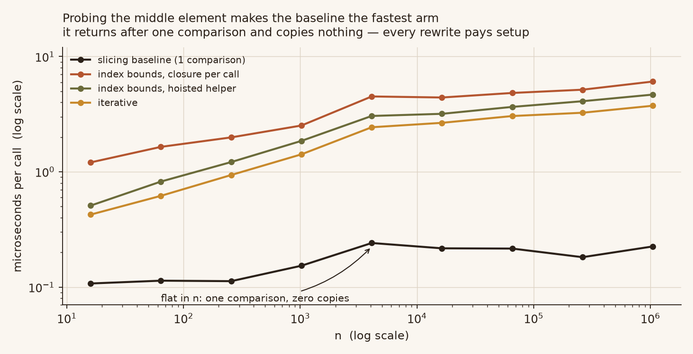

# binary-search-slice-lab

四个二分查找实现，以及对「切片为什么慢」这个流传很广的解释的三处更正。

常见的说法是：`a_list[:midpoint]` 会复制列表，递归深度是 `log n`，所以总量是
`Θ(n log n)`。只有第一句是真的。切片只保留**一半**，复制量是
`n/2 + n/4 + n/8 + … = n` —— 线性，不是 `n log n`。用一个会统计复制元素数的
list 子类实测，`copies / n` 在 n 跨 256 倍的范围内稳定在 **1.00**。

同一篇材料里的另外两条也站不住：说切片版「更早撞递归上限」，说改写「在每种规模上都更快」。
两版递归深度完全相同；而在 n < 256 时，改写版比它要替换的代码更慢。

```
                        相对切片基线的加速比
                        查找末元素            查找中间元素
                        n=16    n=1,048,576   n=16   n=1,048,576
  切片基线              1.00x      1.00x      1.00x      1.00x
  索引 + 每次建闭包      0.52x     933x       0.09x      0.04x
  索引 + 模块级辅助函数  1.06x   2,089x       0.20x      0.05x
  迭代                   1.29x   2,608x       0.25x      0.06x
```

右边两组要一起读。同一个改写，在一个工作负载上值 2,608×，在另一个上慢 16×，
而两者都是对同样大小的有序列表做诚实的二分查找。

## 复杂度那条，一张图


左图：每次查找复制的元素数除以 n，是平的。`Θ(n log n)` 会随 `log n` 往上爬，这里不动。
右图：绝对复制数对 `n` 和 `n log n` 两条参考线 —— 它贴着 `n`。

统计方式是在 `list` 子类上拦截 `__getitem__`，并且把切片结果**重新包一层**，这样嵌套层级
也会被统计到。直接返回普通 `list` 的计数器只看得到第一层，报出 `0.5n` —— 恰好就是那个
让 `n log n` 说法看起来合理的数字。

**这张图里没有时钟。** `benchmarks/ops.py --check` 在 CI 里重算每一格，有任何漂移就失败，
所以这个结论不是测量伪影。

## 加速比取决于你查哪个元素


同样四个实现、同样 n 范围，两个不同的目标位置。

查**中间**元素时，基线一次比较就返回、一个元素都不复制。这时每个改写都在付自己的启动成本，
慢 10–25×。查**末**元素时，基线每层都要切片，改写赢三个数量级。

哪一栏都不是「真正的答案」。只测 `data[len//2]` —— 被审查的那份材料就是这么做的 ——
量到的是退化情形，报出的数字只在那里成立。两个都得报，否则数字没有意义。



绝对值上也是同一件事：基线停在约 0.2 µs，几乎不随 n 变化；每个改写从 0.4 µs 爬到 4–6 µs。
改写并不慢 —— 它们在付一笔基线根本不会产生的固定启动成本，因为基线早就返回了。

## 三步里只有一步随 n 增长


四个实现，每个只跟前一个差一个想法：

| 这一步 | 改了什么 | 值多少 |
|---|---|---|
| 切片 → 索引+闭包 | 不再复制列表 | 0.52x → 933x，随 n 增长 |
| 索引+闭包 → 模块级 | 不再每次调用重建闭包 | 稳定 **1.2–2.2x** |
| 模块级 → 迭代 | 不再递归 | 稳定 **1.15–1.37x** |

后两步是常数因子收益。它们是真的，加起来约 2×，但不改变复杂度量级 —— 而第一步单独就值 933×。
只报总数、不拆开，等于把贵的那一步的功劳记在便宜的步骤上。

闭包那一步特别值得说，因为它是**负优化**。被审查的包里 `binary_search` 在函数体内定义
`_search`，所以每次调用都先分配一个函数对象再开始查找。这个成本约 0.3 µs，与 n 无关 ——
这就是为什么这个「优化」版在小规模上比原版还慢。

## 实测数字

逐轮比值中位数，9 轮交错，Windows 上的 CPython 3.13.12。方括号是 p10–p90。
这里故意不给绝对微秒数：同一段代码在单进程内能漂 3×，只有量级意义，原始值在
`benchmarks/timing.json`。

目标 = 末元素（切片真正伤人的形状）：

| n | 去掉切片 | 去掉闭包 | 去掉递归 | 合计 |
|---|---|---|---|---|
| 16 | 0.52 [0.44–0.60] | 2.04 [1.86–2.86] | 1.17 [0.97–1.32] | 1.29x |
| 256 | 0.91 [0.77–1.09] | 1.62 [1.46–1.76] | 1.26 [1.19–1.48] | 1.96x |
| 4,096 | 3.69 [3.06–4.22] | 1.68 [1.33–2.03] | 1.21 [0.88–1.29] | 6.93x |
| 65,536 | 94.4 [65.7–110.3] | 1.35 [1.10–4.40] | 1.35 [1.03–1.56] | 168x |
| 1,048,576 | 933 [710–1,112] | 2.24 [1.72–3.04] | 1.37 [1.28–1.61] | 2,608x |

目标 = 中间元素（退化探针）：

| n | 去掉切片 | 合计 |
|---|---|---|
| 16 | 0.09 [0.08–0.12] | 0.25x |
| 256 | 0.06 [0.04–0.07] | 0.12x |
| 65,536 | 0.04 [0.03–0.05] | 0.07x |
| 1,048,576 | 0.04 [0.03–0.04] | 0.06x |

中间元素那一栏的「去掉切片」在每个 n 上都**小于 1**：没有切片可去，去掉它只会让实现更慢。
这正是要报两个位置的全部理由。

## 递归深度：完全一样

被审查的材料说切片版「因为额外的工作会更早撞递归上限」。用 `sys.setprofile` 实测最大
Python 调用栈深度，两版相同：

| n | 切片版 | 索引版 | ⌊log₂n⌋+1 |
|---|---|---|---|
| 1,024 | 12 | 12 | 11 |
| 262,144 | 20 | 20 | 19 |
| 1,048,576 | 22 | 22 | 21 |

深度由「砍几次半」决定，两版砍法相同。每层多复制数据只是多占内存，不加栈帧。
两版都能跑到 n = 5,000,000 而不接近上限。

## 判空不是风格问题

上游用 `len(a_list) == 0` 判空。被审查的改写用 `if not a_list`，这会调 `bool()`。
对 `numpy.ndarray`，多于一个元素的 `bool()` 直接抛异常：

| 输入 | 上游 | 改写版 |
|---|---|---|
| `np.arange(100)`, 50 | `True` | **`ValueError`** |
| `np.arange(100)`, -1 | `False` | **`ValueError`** |
| `np.array([])`, 1 | `False` | **`ValueError`** |

上游自己的 doctest 就传了 `range`，所以文档承诺的契约是「任意序列」。这个改写悄悄踢掉了
所有 ndarray 调用方。本仓库全程用 `len()`，`tests/test_correctness.py` 断言没有任何实现
会碰输入的 `__bool__`。

## 测试套件必须能抓到什么

被审查那个包的 19 条 doctest 在它自己代码上全绿，这证明不了什么。往里注入 9 个缺陷，
三个活过了全部 19 条：

| 注入的缺陷 | 活下来了？ | 2 万组随机输入里的错误率 |
|---|---|---|
| 迭代版 `else: break` | 是 | **21.5%** |
| 迭代版 `hi = mid - 2` | 是 | **6.3%** |
| 迭代版 `mid = lo` | 是 | 0%，但 n=64,000 时**慢 2,212×** |

根因是覆盖不对称：迭代版只带了 3 条 doctest，递归版继承了上游全部 14 条。第三个缺陷
在所有输入上都返回正确答案，任何行为测试都看不见它 —— 只有读取计数器能。

`tests/test_counts.py::TestMutationCoverage` 把这三个缺陷对着本仓库的计数器重跑一遍，
断言每一个都被抓住。

## 安装与运行

```bash
python -m unittest discover -s tests -t . -v   # 18 个测试
python -m doctest bsearch/core.py -v           # 10 条 doctest
python benchmarks/ops.py                       # 精确计数，不含时钟
python benchmarks/ops.py --check               # CI 模式：有漂移即失败
python benchmarks/timing.py                    # 写 benchmarks/timing.json
python benchmarks/timing.py --no-write --quick # CI 冒烟
python assets/make_figures.py                  # 需要 matplotlib
```

库和测试零依赖。`matplotlib` 只用于画图。

## 四个实现

| 名字 | 是什么 |
|---|---|
| `binary_search_slicing` | 上游原样。基线。 |
| `binary_search_index_closure` | 索引边界，每次调用重建闭包 |
| `binary_search_index` | 索引边界，辅助函数在模块级 |
| `binary_search_iterative` | 循环，无递归 |

## 出处

基线是 [TheAlgorithms/Python](https://github.com/TheAlgorithms/Python) 的
`searches/simple_binary_search.py`，MIT 协议，Copyright (c) 2016-2022 TheAlgorithms
and contributors。只改了函数名。`tests/test_correctness.py` 断言基线仍保持上游形状，
防止有人把它悄悄「整理」得更快、让对比失去意义。

其余全部是新的。逐条论断的审计见 [`docs/CLAIMS.md`](docs/CLAIMS.md)。

## 协议

MIT —— 见 [`LICENSE`](LICENSE)。
